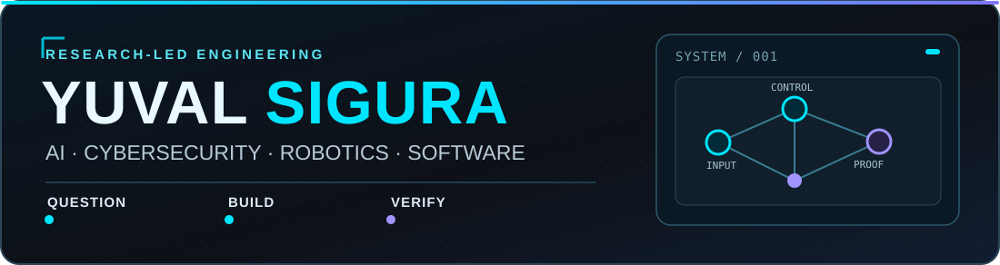
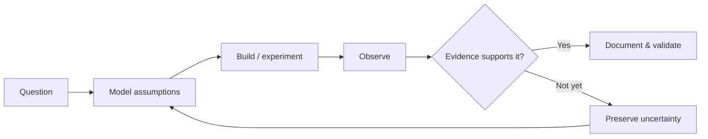

### I turn hard questions into systems you can build, test, and verify.

**Computer Science · AI Systems · Security Research · Robotics · Software Engineering**

[**Explore my work ↓**](#featured-work) · [**Engineering approach**](#how-i-engineer) · [**Tech stack**](#technical-toolbox) · [**Connect**](#lets-connect)

---

## The short version

I'm **Yuval Sigura** — a computer science student, software developer, and independent technology researcher who enjoys working where **AI, cybersecurity, infrastructure, and physical systems meet**.

I don't just explore how a system *could* work. I like building the prototype, defining the failure modes, writing the tests, and finding out **what the evidence actually supports**.

My public work ranges from a research archive for understanding vulnerability discoveries to a controlled SaaS security laboratory, an autonomous Jetson/ESP32 rover, local multi-agent coordination software, and an interactive study application.

**What connects these projects:** turning ambitious ideas into inspectable engineering — with clear authorization, observable behavior, and honest limits on what has been proven.

## Featured work

SELECTED PUBLIC PROJECTS · REAL CODE, DOCUMENTATION, AND TESTABLE ARTIFACTS

### 🔬 [Research Discovery Lab](https://github.com/YuvalSigura/Research-Discovery-Lab) — Reconstructing how discoveries happen

**The question:** Can we learn from the *investigative decisions* behind a security finding, not just its final exploit?

**The engineering:** A Python research archive with typed records, source provenance, validation, deterministic retrieval, chronology, and question-first analysis. It distinguishes observed evidence from reconstructed or inferred reasoning.

**What to inspect:** [Research methodology and verified status](https://github.com/YuvalSigura/Research-Discovery-Lab#verified-project-status) · [Archive validation CI](https://github.com/YuvalSigura/Research-Discovery-Lab/actions)

`Python` · `Research infrastructure` · `Evidence modeling` · `Validation`

### 🛡️ [HELIOS](https://github.com/YuvalSigura/HELIOS) — A security lab where an agent cannot grade itself

**The question:** How do you know whether an autonomous Web/API security investigation actually succeeded?

**The engineering:** A deliberately vulnerable, **local-only**, multi-tenant SaaS testbed. FastAPI, PostgreSQL, Redis, a background export worker, object storage, and an **independent operator oracle** provide a realistic workflow and a way to check actual outcomes.

**What to inspect:** [Architecture, boundaries and validation status](https://github.com/YuvalSigura/HELIOS)

`FastAPI` · `PostgreSQL` · `Redis` · `Docker` · `Security testing`

### 🤖 [SpectraRover](https://github.com/YuvalSigura/autonomous_robot) — Taking software into the physical world

**The question:** How can autonomous navigation remain predictable when software controls real motors?

**The engineering:** A Jetson Orin Nano / ESP32 rover stack with mecanum kinematics, bounded serial motor commands, arming and watchdog behavior, camera calibration, ArUco perception, route control, and deterministic tests.

**Reality check:** The pre-RF software is implemented and CI-tested; some chassis-specific electrical and physical integration checks remain.

`Jetson Orin Nano` · `ESP32` · `Python` · `OpenCV` · `Embedded control`

### 🔗 [ONE](https://github.com/YuvalSigura/one) — Coordinating AI tools without surrendering control

**The question:** How can multiple developer agents collaborate while keeping tasks, approvals, and execution accountable?

**The engineering:** A local MCP coordination layer using persistent SQLite state, task/event records, approved CLI workers, Git worktrees, and offline tests. Its documented boundaries explicitly distinguish coordination from an operating-system security boundary.

**What to inspect:** [Implemented features and integration limits](https://github.com/YuvalSigura/one)

`Python` · `MCP` · `SQLite` · `Agent tooling` · `Workflow engineering`

---

## Also worth exploring

**🔍 [Train Ticket — Security Assessment](https://github.com/YuvalSigura/train-ticket-Analysis-Report)**  
A public, sanitized penetration-testing report covering Web/API analysis, validated findings, risk, evidence, and remediation guidance. A look at how I document security work, not just how I test.

**📚 [Exam Recall — Live web app](https://yuvalsigura.github.io/)** · [Source](https://github.com/YuvalSigura/yuvalsigura.github.io)  
A Hebrew study application with active recall, weak-topic practice, and local progress tracking. A working user-facing product alongside the research and infrastructure projects.

**Other public explorations:** [C#/.NET binary analysis tooling](https://github.com/YuvalSigura/PuaSuiteClean) · [Wi-Fi CSI sensing resources](https://github.com/YuvalSigura/esp-csi). Check individual repositories for original upstream attribution, scope, and maturity.

## What I bring to an engineering team

| Strength | What that looks like in practice |
|:--|:--|
| **Research discipline** | Turning uncertainty into explicit questions, source-backed records, and testable hypotheses |
| **Security-minded design** | Authorization boundaries, negative controls, fail-safe behavior, and independent outcome checks |
| **Cross-layer engineering** | Moving between Python services, APIs, local infrastructure, microcontrollers, and physical platforms |
| **Ownership of the whole loop** | Architecture, implementation, test cases, documentation, and evaluation — not just a demo |

I'm particularly interested in **AI systems engineering, security R&D, backend/platform engineering, and autonomous systems**.

## How I engineer

### Models propose. Systems authorize. Evidence decides.

*“How do you know that happened?”*

A useful result has to survive contact with reality. In my projects, that means separating what a model says from what a test, artifact, or physical observation can establish.

<strong>▶ See the evidence-first development loop</strong>

**My rule:** implemented ≠ tested ≠ validated in the intended environment. A roadmap item isn't an achieved result.

## Technical toolbox

<strong>▶ Open the full technology and research map</strong>

| Domain | Tools and areas |
|:--|:--|
| **Software / backend** | Python, C, C#, .NET, JavaScript, Web APIs, local services, SQLite, PostgreSQL |
| **Infrastructure** | Linux, Windows, Docker, Git, GitHub Actions, CI/CD, automation |
| **Security** | Web/API assessment, penetration-testing methodology, OWASP, Burp Suite, Nmap, SAST/DAST concepts |
| **AI / research** | AI agents, model evaluation, machine learning, OpenCV, experiment design, benchmarks |
| **Robotics / embedded** | Jetson Orin Nano, ESP32, computer vision, sensor integration, motor control |
| **Signals / low-level** | Wi-Fi CSI sensing, signal analysis, OS internals, binary inspection, reverse-engineering research |

This is an overview of technologies used or explored across public work and broader engineering interests, not a claim that every area is equally mature.

## Beyond a single discipline

I like projects that connect ideas normally kept in separate boxes: **security research with scientific evidence, AI tooling with reliable infrastructure, and autonomy with low-level hardware control**.

The common theme isn't a particular framework. It's the habit of asking difficult questions, implementing useful systems, and verifying the results.

<strong>▶ GitHub activity and language overview</strong>

---

## Let's connect

Interested in **research-driven engineering, reliable AI, security systems, or robotics**? I'm open to engineering opportunities, technical discussions, and collaboration.

**Build with curiosity. Test with discipline. Publish what the evidence supports.**

