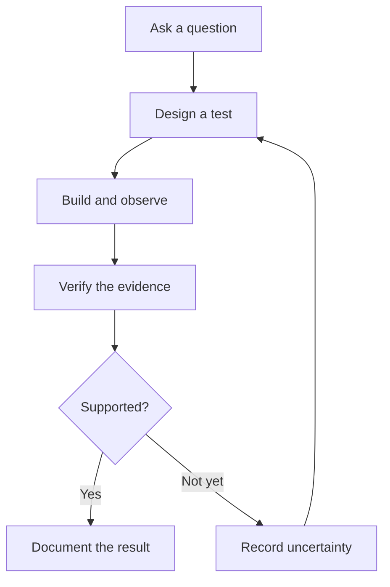

<div align="center">


**I build systems that don't trust the model.**


<p align="center">
  <strong>AI Research · Cybersecurity · Software Engineering</strong><br/>
  <strong>Robotics · Embedded Systems</strong>
</p>


</div>

<p align="center">
  <a href="#about-me">About</a> ·
  <a href="#areas-of-focus">Focus</a> ·
  <a href="#selected-public-projects">Projects</a> ·
  <a href="#toolbox">Toolbox</a> ·
  <a href="#engineering-loop">Workflow</a> ·
  <a href="#connect">Connect</a>
</p>

---

## About me

I'm **Yuval Sigura**, a computer science student, developer, and independent technology researcher working across artificial intelligence, cybersecurity, software engineering, and autonomous systems.

My work and technical interests span the engineering stack — from embedded devices, operating systems, wireless sensing, and physical computing to backend services, web applications, machine learning, and research infrastructure.

I value **reproducible experiments, explicit security boundaries, measurable results, and evidence that can be checked independently**.

### Developer console

```text
yuval@engineering:~$ whoami
CS student | Developer | Independent researcher

yuval@engineering:~$ ls focus/
ai  cybersecurity  robotics  embedded  backend

yuval@engineering:~$ cat principles.txt
Question -> Build -> Test -> Verify -> Learn
```

## Areas of focus

- **Artificial Intelligence & Machine Learning** — AI agents, model evaluation, machine learning, computer vision, and intelligent automation.
- **Cybersecurity & Security Engineering** — authorized penetration testing, Web/API security, vulnerability assessment, defensive tooling, and security research.
- **Robotics & Autonomous Systems** — navigation, motion control, visual perception, sensor integration, and edge computing.
- **Embedded & Low-Level Systems** — microcontrollers, embedded Linux, systems programming, hardware/software integration, and OS internals.
- **Wireless Sensing & Signal Processing** — Wi-Fi CSI, RF fundamentals, signal analysis, and sensing-related experimentation.
- **Software & Web Development** — Python, C, C#, JavaScript, .NET, web applications, and developer tools.
- **Backend Systems & Infrastructure** — APIs, local services, persistent state, Docker, Linux, Git, CI/CD, and workflow automation.
- **Reverse Engineering & Binary Analysis** — binary inspection, patching, and low-level security-oriented experimentation.
- **Research & Evaluation** — experimental design, benchmarking, provenance, reproducibility, and independent validation.

## Toolbox

<details>
<summary><strong>🧰 Explore my tech stack</strong> — expand to see languages, tools and platforms</summary>

**Languages & web:** Python · C · C# · JavaScript · HTML · CSS · .NET

**Systems & infrastructure:** Linux · Windows · Git · GitHub Actions · Docker · CI/CD · APIs

**Security & testing:** Web/API assessment · Burp Suite · Nmap · static analysis · vulnerability validation

**AI & research:** Machine learning · LLM/agent tooling · OpenCV · benchmarking · evaluation

**Hardware & sensing:** Jetson Orin Nano · ESP32 · robotics · Wi-Fi CSI · sensor integration

</details>

<div align="center">

### The question behind the work

> "How do you *know* that happened?"

A system's output is more useful when its underlying evidence can be inspected — not merely accepted because a model sounds confident.

</div>


## How I approach engineering

For security-sensitive and autonomous systems, I aim to keep **reasoning, authorization, execution, and verification** separate.

An agent can recommend an action without granting itself permission to execute it. A test can produce an apparent success without proving that the expected state changed. A research record can contain a hypothesis without treating it as an established fact.

These principles appear in my public work through:

- Research tools that preserve uncertainty and source provenance.
- Controlled security laboratories that verify outcomes using independent evidence.
- Robotics software with explicit arming, bounded motor commands, and fail-safe behavior.
- Engineering workflows that distinguish implemented, tested, and proposed capabilities.

**Models propose. Systems authorize. Evidence decides.**

## Engineering loop

The same evidence-first process guides how I approach software, security assessments, and robotics experiments:



## Selected public projects

| Project | Focus and demonstrated work |
|:---|:---|
| 🔬 **[Research Discovery Lab](https://github.com/YuvalSigura/Research-Discovery-Lab)** | Evidence-grounded security research archive, question-first investigation reconstruction, provenance tracking, and evaluation infrastructure. |
| 🛡️ **[HELIOS](https://github.com/YuvalSigura/HELIOS)** | Intentionally vulnerable, locally controlled multi-tenant SaaS security lab with Web/API workflows and independent artifact verification. |
| 🤖 **[SpectraRover](https://github.com/YuvalSigura/autonomous_robot)** | Jetson Orin Nano / ESP32 research rover; motor control, fail-safe communication, camera support, and visual navigation. Hardware-specific integration remains subject to verification. |
| 🔗 **[ONE](https://github.com/YuvalSigura/one)** | Local multi-agent MCP coordination, durable task state, explicit approvals, and reproducible development workflows. |
| 🔍 **[Train Ticket Security Assessment](https://github.com/YuvalSigura/train-ticket-Analysis-Report)** | Documented penetration-testing methodology, Web/API vulnerability analysis, evidence-backed findings, and remediation reporting in an educational test environment. |
| 📚 **[Exam Recall](https://github.com/YuvalSigura/yuvalsigura.github.io)** | Interactive Hebrew web application for exam preparation, active-recall practice, weak-topic review, and local learning-progress tracking. **[Live app](https://yuvalsigura.github.io/)** |

Additional public explorations include [binary analysis and patching in C#/.NET](https://github.com/YuvalSigura/PuaSuiteClean) and [Wi-Fi CSI sensing](https://github.com/YuvalSigura/esp-csi). Refer to individual repositories for scope, attribution, and project status.

## Current interests

I'm especially interested in reliable AI systems, security engineering, autonomous robotics, sensor-driven computing, and tools that make complex software easier to test and understand.

Across these areas, I try to make a clear distinction between **what is implemented, what has been tested, and what is still experimental**.


## GitHub activity

<div align="center">


### Connect

[](https://www.linkedin.com/in/yuvalsigura)
[](https://github.com/YuvalSigura)

*Open to opportunities and collaborations in AI, cybersecurity, software engineering, and autonomous systems.*


</div>
